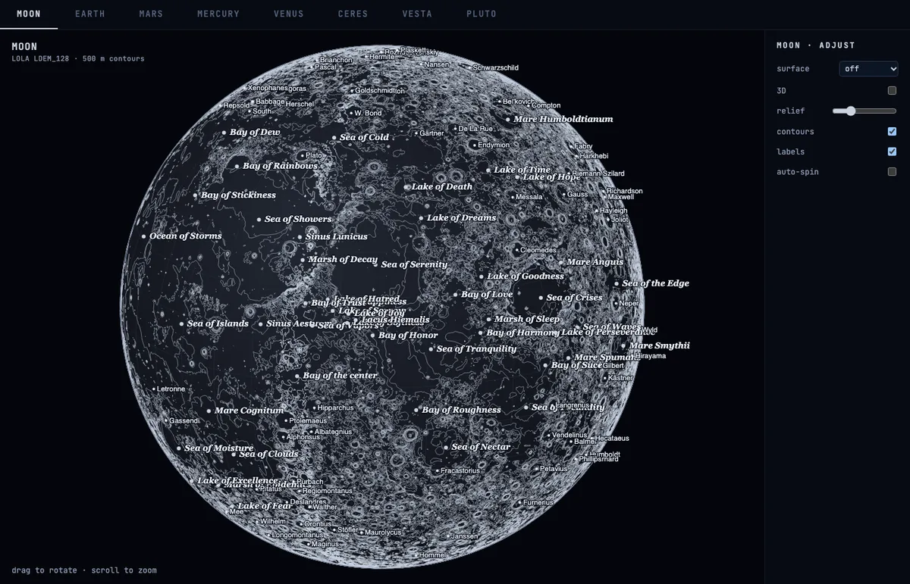
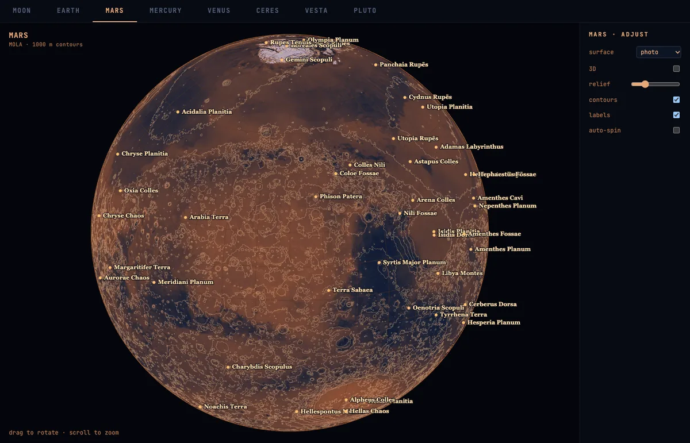
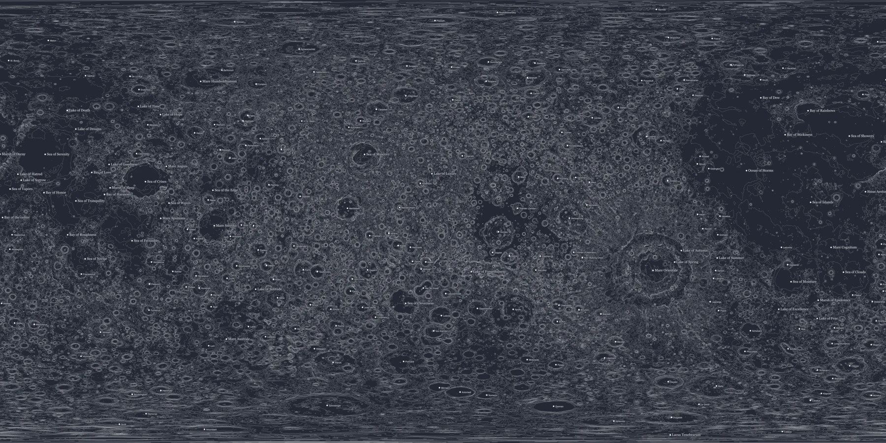

<center><h1 align="center">🪐 Planeteria</h1></center>

<p align="center">Contour maps and interactive WebGL globes for eight worlds, built from real planetary elevation models.</p>

<p align="center">
  <a href="https://melvinchia3636.github.io/planeteria/"><strong>Live demo →</strong></a>
</p>

## 🤔 The Problem

Planetary elevation data is abundant but painful to use. Every body ships as a
multi-gigabyte raster in a different format (PDS3 labels, GeoTIFF), with its own
projection, longitude convention, nodata value, vertical scale and feature
naming. Turning those into consistent, good-looking maps and globes normally
means heavy GIS tooling and a separate script per planet.

## 💡 The Solution

Planeteria is one config-driven pipeline plus a static WebGL viewer. A single
`config.py` entry describes each body; everything else is shared.

- **Eight bodies, one pipeline** — Moon, Earth, Mars, Mercury, Venus, Ceres,
  Vesta and Pluto all run through the same `build.py` tasks.
- **Real data, no mock-ups** — LOLA, ETOPO, MOLA, MESSENGER, Magellan, Dawn and
  New Horizons elevation and imagery.
- **Hybrid renderer** — a WebGL sphere samples an equirectangular texture while
  a d3 geo-orthographic canvas draws contours, graticules and labels on top.
- **3D terrain** — displace the sphere with the DEM, with a vertical-exaggeration
  slider; a structure-only "clay" mode when the surface is off.
- **Flat maps** — hypsometric relief, true-colour draped hillshade, SVG contour
  maps and labelled PNGs (4000 px and 25600 px).
- **Smart labels** — IAU Gazetteer features for the planets, Natural Earth
  populated places for Earth, with greedy collision rejection.
- **Small payload** — WebP textures and delta-varint contours keep all eight
  globes at ~31 MB instead of ~172 MB.
- **Reproducible** — `make` builds everything; generated data is cached and
  parallelised.

## 🖥 Screenshots

<div align="center">
  
  
</div>

<div align="center">
  
</div>

## 🔬 Technologies Used


## ⌨️ Setup

1. Clone the repository and install [uv](https://docs.astral.sh/uv/):
   ```bash
   git clone https://github.com/melvinchia3636/planeteria.git
   cd planeteria
   uv sync
   ```
2. Drop each body's DEM and surface raster into `data/<body>/`. Filenames,
   products and providers are listed in [`DATA_SOURCES.md`](DATA_SOURCES.md).
3. Build:
   ```bash
   make          # every body
   make mars     # one body
   ```
4. Open the viewer:
   ```bash
   python -m http.server -d web 8000
   # then open http://localhost:8000/
   ```

`web/index.html` also works directly from disk (`file://`); assets are embedded
so no server is strictly required.

## 🗂 Layout

```
data/<body>/        DEM + surface rasters, extracted feature catalogues
scripts/planets/    the whole pipeline
  config.py           per-body configuration (rasters, styling, naming)
  common.py           DEM/colour readers + latitude-aware hillshade
  build.py            task CLI (relief, truecolor, contours, …)
output/<body>/      generated PNG maps (+ optional flat SVG)
web/<body>/         generated globe data (JS globals, loaded lazily)
web/index.html      the tabbed globe viewer
web/d3.min.js       bundled d3 build
docs/               README screenshots
```

## ⛏ Building

The Makefile wraps `scripts/planets/build.py`:

| Command | What it does |
|---|---|
| `make` | every body (`all`) |
| `make <body>` | relief, true colour, contours, textures, height, catalogue, labels |
| `make flat-all` / `make flat-<body>` | flat contour SVG + labelled SVG |
| `make png-all` / `make png-<body>` | rasterise the flat maps to 4000 px and 25600 px PNGs |
| `make labeled` | collect the medium labelled PNGs into `output/labeled/` |
| `make pages` | publish `web/` to the `gh-pages` branch |
| `make clean` | remove outputs, generated web data and `.cache/` |

Task-by-task:

```bash
uv run scripts/planets/build.py all mars      # everything for Mars
uv run scripts/planets/build.py relief moon   # just the hypsometric relief map
```

Tasks: `relief`, `truecolor`, `contours`, `texture`, `height`, `catalog`,
`labels`, `flat`, `flatlabels`. Each writes to `output/<body>/` and
`web/<body>/` and defines the globals
`window.<BODY>_{CONTOURS,LABELS,TEXTURE,ELEV,HEIGHT}`.

## 🌍 Data Sources

Every elevation model, surface mosaic and label source — with product names,
providers, download locations and processing settings — is documented in
[`DATA_SOURCES.md`](DATA_SOURCES.md).

The Moon's DEM is a headerless `.IMG` with a PDS3 `.LBL`; GDAL's PDS driver
reads it via the label, and `common.read_dem` auto-detects projected (metres)
versus geographic (degrees, e.g. ETOPO) grids.

## 🚀 Publishing

The generated globe data under `web/` is gitignored, so the site is published
from a separate `gh-pages` branch rather than `main`:

```bash
make pages   # rebuild gh-pages from web/ and push
```

GitHub Pages serves that branch at
<https://melvinchia3636.github.io/planeteria/>. Rerun `make pages` after
rebuilding any body's web assets.

## ➕ Adding a Body

1. Drop the DEM + surface GeoTIFFs into `data/<body>/`.
2. Add an entry to `scripts/planets/config.py` (rasters, `scale`, `nodata`,
   `radius` for geographic DEMs, `interval`, theme colours).
3. `make <body>`.

## ⚡ Performance

The per-body work is parallelised and cached:

- Decimated DEM fields are cached under `.cache/`, so `relief`, `truecolor`,
  `contours`, `height` and `flat` share one read of the (often multi-GB) raster.
- Surface textures are embedded as **WebP** (quality 80/90) rather than PNG.
- Contours are **delta + varint** encoded at 0.01° precision and decoded back to
  GeoJSON in the browser.
- Contour extraction runs across `cpu_count()-1` processes, one level at a time.
- PNG output uses zlib level 1.

The Moon's contours build in about 7 s and its relief map in about 4 s. All
eight interactive globes together weigh ~31 MB (~21 MB gzipped).

## 📈 Status

This project is completed. If any bugs are found, please file an issue and feel
free to contribute!

## 🙏 Acknowledgements

Built on the work of [USGS Astrogeology](https://astrogeology.usgs.gov/), the
NASA SVS [CGI Moon Kit](https://svs.gsfc.nasa.gov/4720), NOAA/NCEI ETOPO, the
IAU Gazetteer of Planetary Nomenclature, Natural Earth, and the d3
geo-orthographic projection.

## 💡 Inspirations

The project was inspired by Sebastian Lague's
[I Made a Pen Plotter to Draw Maps of the Moon](https://www.youtube.com/watch?v=qyNWDzO6kKQ).

## 📄 License

Copyright © 2026 Melvin Chia<br/>
Licensed under the [MIT License](LICENSE).
